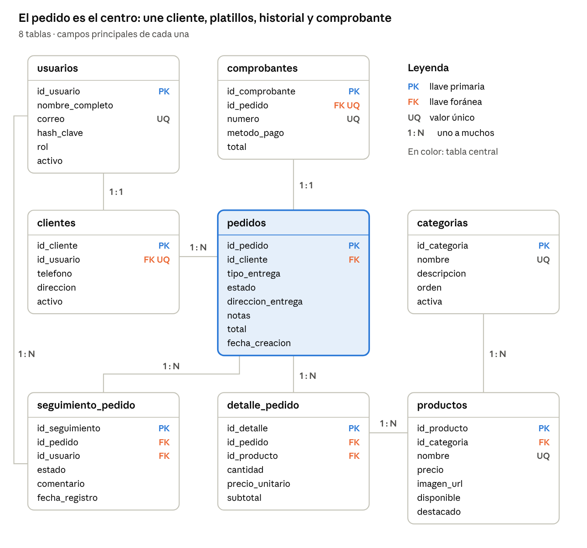

<p align="center"></p>

# Sadu Pedidos

## Descripción
Aplicación web para gestionar los pedidos de **Sadu Restaurant**: menú por categorías, carrito, pedidos con detalle,
tablero de cocina con estados, entrega con comprobante, mantenimiento de menú y clientes, dashboard y reportes.
Proyecto integrador del **Equipo 8 "Los intocables" — Pedidos para restaurantes**,
módulo Desarrollo de Aplicaciones Multiplataforma (COIDS3504), ITCA-FEPADE.

## Tecnologías
- Java JDK 11
- Servlets 4.0, JSP, EL y JSTL 1.2 (`javax.*`)
- Apache Tomcat 9
- Apache NetBeans + Maven
- MySQL 8 + JDBC (`PreparedStatement`, transacciones)
- Arquitectura MVC + DAO + capa de servicios
- Chart.js (gráficas del dashboard, se carga desde internet)

## Instalación desde cero

### 1. Requisitos
- JDK 11 o superior (`java -version`).
- Apache Tomcat 9 registrado en NetBeans (Tools → Servers).
- MySQL 8 y MySQL Workbench.

### 2. Base de datos
En MySQL Workbench, con la cuenta **root**, ejecutar en este orden:

| Script | Qué hace |
| --- | --- |
| `sql/00_crear_bd_y_usuario.sql` | Crea la base `sadu_db` y el usuario de la aplicación `sadu_app` (solo una vez) |
| `sql/01_esquema_sadu.sql` | Crea las 8 tablas (borra y vuelve a crear todo) |
| `sql/02_datos_prueba.sql` | Carga usuarios, menú y pedidos de prueba |

Opcionales: `sql/03_consultas_pantallas.sql` (consultas de cada pantalla) y
`sql/04_pruebas_integridad.sql` (comprueba que las restricciones rechazan datos inválidos).

> Para dejar los datos como al inicio, basta con volver a ejecutar `01` y `02`.

### 3. Conexión
Copiar `src/main/resources/db.properties.example` en la **misma carpeta** con el nombre `db.properties`.
Si se ejecutó `sql/00`, no hay que cambiar nada. `db.properties` está en `.gitignore` y **nunca se sube a GitHub**.

### 4. Ejecutar
1. Abrir la carpeta en NetBeans (File → Open Project).
2. **Clean and Build** y luego **Run** sobre Tomcat 9.
3. Abrir `http://localhost:8084/SaduPedidosDam/` (el puerto puede ser 8080 según la instalación de Tomcat).

## Usuarios de prueba
Todos con la clave **`Sadu2026`**.

| Rol | Correo | Qué puede hacer |
| --- | --- | --- |
| Cliente | `ana.martinez@demo.local` (y otros `@demo.local`) | Menú, carrito, pedidos, comprobante, perfil |
| Cocina | `cocina@sadu.local` | Tablero: preparar, marcar listo, enviar, cancelar, **entregar y cobrar** |
| Administrador | `admin@sadu.local` | Dashboard, reportes, menú y categorías, clientes; ve el tablero sin cobrar |

## Pantallas y rutas
| Ruta | Pantalla | Rol |
| --- | --- | --- |
| `/inicio`, `/login`, `/registro`, `/salir` | Inicio y acceso | Todos |
| `/cliente/productos` | Menú con filtros por categoría | Cliente |
| `/cliente/carrito` | Carrito y confirmación del pedido | Cliente |
| `/cliente/pedidos/lista` | Mis pedidos | Cliente |
| `/cliente/pedidos?accion=detalle&id=…` | Detalle y seguimiento del pedido | Cliente |
| `/cliente/pedidos?accion=comprobante&id=…` | Comprobante imprimible | Cliente |
| `/cliente/perfil` | Mi perfil y cambio de clave | Cliente |
| `/panel` | Inicio del panel interno | Cocina y administrador |
| `/cocina/tablero` | Tablero de cocina | Cocina y administrador |
| `/admin/dashboard` | Dashboard gerencial | Administrador |
| `/admin/reportes` | Reportes por rango de fechas (imprimible) | Administrador |
| `/admin/productos` | Mantenimiento de platillos | Administrador |
| `/admin/categorias` | Mantenimiento de categorías | Administrador |
| `/admin/clientes` | Mantenimiento de clientes | Administrador |

`AccesoFilter` protege `/cliente/*`, `/cocina/*`, `/admin/*` y `/panel` según el rol.

## Estructura
```
src/main/java/sv/edu/itca/sadu/
  controller/   Servlets: reciben la petición y eligen la vista
  service/      Reglas de negocio y transacciones (PedidoService, ServicioCategoria...)
  dao/          Interfaces DAO + implementaciones JDBC (solo SQL)
  model/        Clases de dominio, DTO y enums (EstadoPedido, TipoEntrega, MetodoPago, Rol)
  filter/       AccesoFilter (rol) y CodificacionFilter (UTF-8)
  util/         ConexionBD (lee db.properties) y Seguridad (hash SHA-256)
src/main/resources/
  db.properties.example   Plantilla de la conexión
src/main/webapp/
  WEB-INF/views/   JSP por módulo (acceso, cliente, cocina, admin, error, plantilla)
  resources/       CSS, JS e imágenes
sql/            00 BD y usuario · 01 esquema · 02 datos de prueba · 03 consultas · 04 pruebas de integridad
docs/           Ficha, roles, guía del equipo, bitácora, matriz de pruebas, evidencias
```

## Base de datos


8 tablas: `usuarios`, `clientes`, `categorias`, `productos`, `pedidos`, `detalle_pedido`,
`seguimiento_pedido` y `comprobantes`. Integridad con llaves foráneas, `UNIQUE`, `CHECK` e índices;
borrado lógico en usuarios, clientes, productos y categorías.

## Equipo y roles
| Integrante | Rol | Módulos |
| --- | --- | --- |
| Ulises Rivera (Dev 1) | Líder, arquitectura y acceso | Repositorio, base técnica, BD, login/registro, filtros, plantillas, comprobante |
| Sarai Villalta (Dev 2) | Menú y clientes | Menú del cliente, platillos, categorías, clientes, perfil |
| Diego Carias (Dev 3) | Pedidos | Carrito, pedido con transacción, mis pedidos, detalle, seguimiento |
| Allison Servano (Dev 4) | Cocina y gerencia | Tablero de cocina, dashboard, reportes |

Detalle completo en [`docs/roles_y_cronograma.md`](docs/roles_y_cronograma.md) y
[`docs/GUIA_EQUIPO.md`](docs/GUIA_EQUIPO.md). Cómo contribuir: [`CONTRIBUTING.md`](CONTRIBUTING.md).

## Avance por guía
| Guía | Tema | Dónde se aplica |
| --- | --- | --- |
| 01 | Entorno y aplicación web | Proyecto Maven en NetBeans + Tomcat 9 |
| 02 | Formularios, sesiones y control de flujo | Login, registro, cookie "recordarme", carrito en sesión |
| 03 | Clases, interfaces y SOLID | Interfaces DAO, servicios con inyección por constructor, enums |
| 04 | Servlets y MVC | Un Servlet por módulo, JSP en `WEB-INF`, filtro por rol, páginas de error |
| 05 | JDBC y MySQL | `ConexionBD`, `PreparedStatement`, usuario de BD con permisos limitados |
| 06 | DAO y CRUD | CRUD de platillos, categorías y clientes |
| 07 | CRUD relacionado y transacciones | Pedido + detalle + seguimiento; entrega + comprobante |