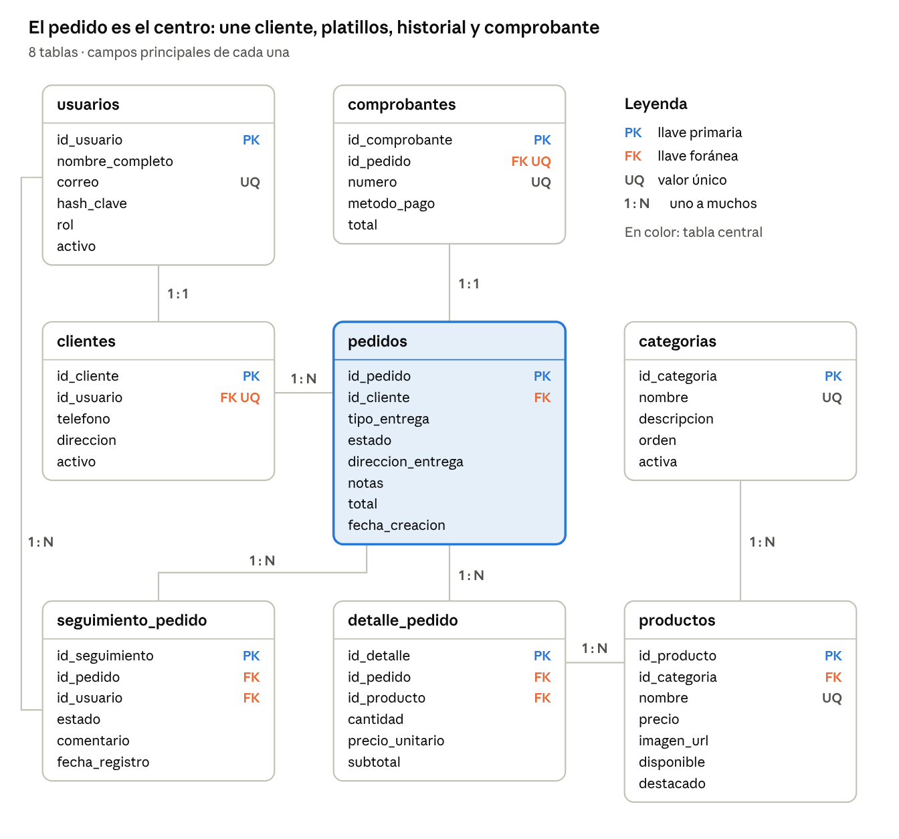

<p align="center"></p>

# Sadu Pedidos

## Descripción
Aplicación web para gestionar los pedidos de **Sadu Restaurant**: clientes, menú, pedidos con detalle,
estados de preparación, entregas y comprobantes. Proyecto integrador del **Equipo 8 — Pedidos para restaurantes**,
módulo Desarrollo de Aplicaciones Multiplataforma (COIDS3504).

## Tecnologías
- Java JDK 11
- JSP, Servlets, EL y JSTL 1.2 (`javax.*`)
- Apache Tomcat 9
- Apache NetBeans + Maven
- MySQL 8 + JDBC + DAO (desde Guía 05)
- JSF + Managed Beans (desde Guía 08)

## Requisitos
1. JDK 11 o superior configurado (`java -version`).
2. Tomcat 9 registrado en NetBeans.
3. Tomcat 9 en su puerto (en NetBeans suele ser 8084 si 8080 está ocupado).
4. MySQL 8 con `sadu_db` creada (ver sección Base de datos).
5. Copiar `src/main/resources/db.properties.example` como `db.properties` en la misma carpeta y poner la clave de MySQL (no se sube a GitHub).

> **¿Vas a programar tu módulo?** Lee primero [`docs/GUIA_EQUIPO.md`](docs/GUIA_EQUIPO.md): rutas, plantilla y clases de estilo.

## Ejecución
1. Clonar: `git clone https://github.com/URG022/SaduPedidosDam.git`
2. Abrir la carpeta en NetBeans (File → Open Project).
3. Clean and Build.
4. Run sobre Tomcat 9.
5. Abrir `http://localhost:8084/SaduPedidosDam/`.

## Estructura
```
src/main/java/sv/edu/itca/sadu/
  controller/   Servlets (y luego Managed Beans)
  model/        Clases de dominio y enums
  service/      Reglas de negocio e interfaces (SOLID)
  dao/          Acceso a datos JDBC
  filter/       AutenticacionFilter, filtros de rol
  listener/     AplicacionListener
  util/         ConexionBD y utilidades
src/main/webapp/
  index.jsp
  WEB-INF/views/   Vistas internas (Guía 04)
  resources/css/estilos.css  Paleta Sadu
  resources/img/logo-sadu.png
sql/            00 BD y usuario · 01 esquema · 02 datos de prueba · 03 consultas por pantalla · 04 pruebas de integridad
docs/           Ficha, roles, cronograma, bitácora, pruebas y evidencias
```

## Base de datos


Ejecutar en MySQL Workbench, en orden: `sql/00_crear_bd_y_usuario.sql` (una vez, como root), `sql/01_esquema_sadu.sql`, `sql/02_datos_prueba.sql`.
Usuarios de prueba (clave `Sadu2026`): `admin@sadu.local`, `cocina@sadu.local`, `ana.martinez@demo.local`.

## Equipo y roles
| Integrante | Rol | Módulos |
| --- | --- | --- |
| Integrante 1 | Líder, arquitectura y acceso | Repo, base técnica, login/registro, filtros, conexión |
| Integrante 2 | Menú y clientes | Categorías, productos, clientes, migración JSF |
| Integrante 3 | Pedidos | Carrito, pedido + detalle, transacción |
| Integrante 4 | BD, cocina, gerencia y documentación | Esquema SQL, tablero de cocina, dashboard, evidencias |

Detalle completo en [`docs/roles_y_cronograma.md`](docs/roles_y_cronograma.md). Cómo contribuir: [`CONTRIBUTING.md`](CONTRIBUTING.md).

## Avance por guía
| Guía | Tema | Estado |
| --- | --- | --- |
| 01 | Entorno y aplicación web | ✅ |
| 02 | Formularios, sesiones y control de flujo | ✅ Login, registro, cookie |
| 03 | Clases, interfaces y SOLID | ⬜ |
| 04 | Servlets y MVC | ✅ Filtro por rol, plantilla, errores |
| 05 | JDBC y MySQL | ✅ Conexión, registro con transacción |
| 06 | DAO y CRUD | ⬜ |
| 07 | CRUD relacionado y transacciones | ⬜ |
| 08 | JSF y Managed Beans | ⬜ |
